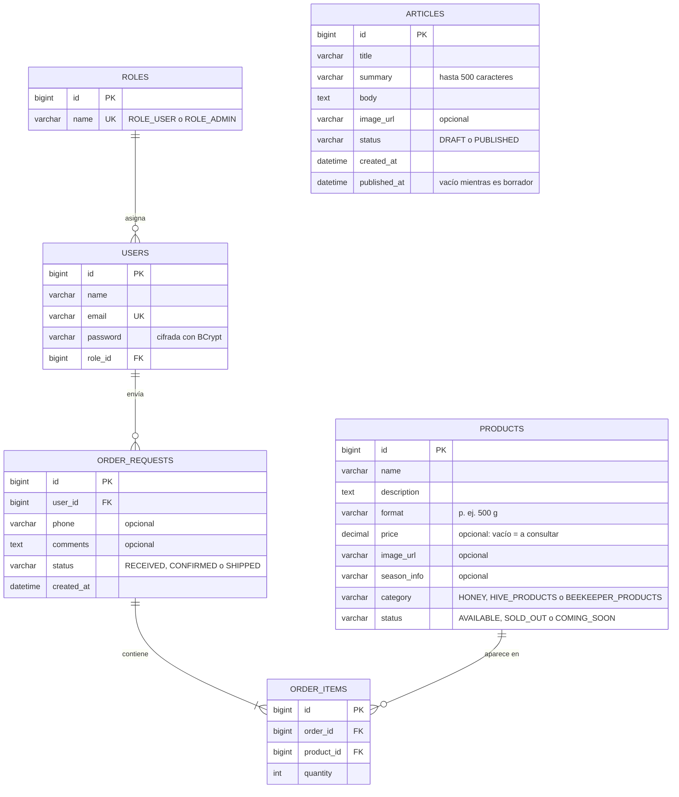
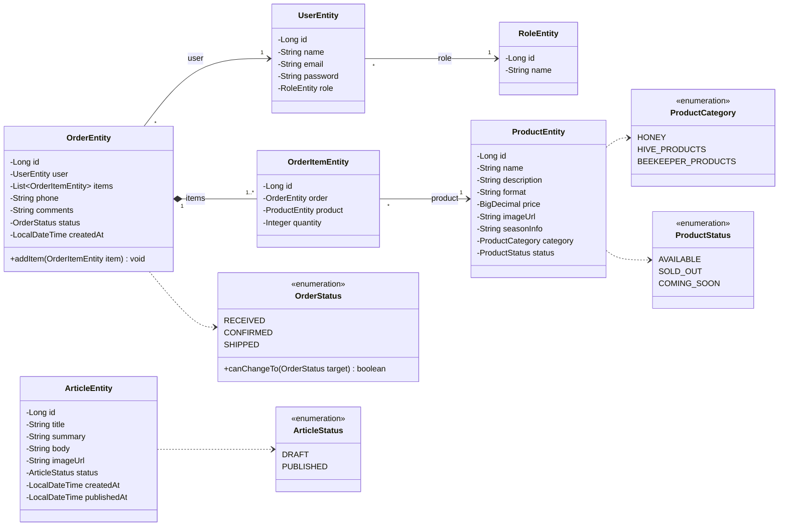
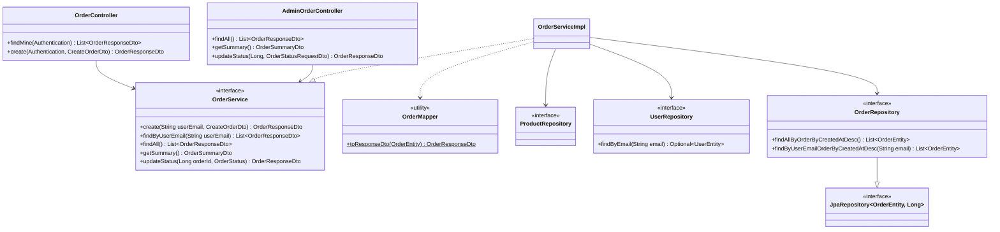
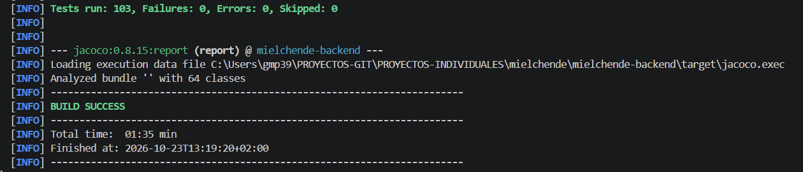

# Miel Chende · Backend

API REST de **Miel Chende**, la web de Apícola Chende, una explotación apícola familiar de Cospeito (Lugo), en la Reserva de la Biosfera Terras do Miño.

Proyecto final individual del bootcamp de desarrollo web full stack de Factoría F5 y, a la vez, una aplicación real para el negocio familiar.

El frontend está en [mielchende-frontend](https://github.com/gmp395/mielchende-frontend).

La presentación del proyecto está en [Canva](https://canva.link/o9bquznrnbz66sf).

La documentación ampliada está en la [wiki](https://github.com/gmp395/mielchende-backend/wiki).

## Índice

- [Descripción](#descripción)
- [Tecnologías](#tecnologías)
- [Arquitectura](#arquitectura)
- [Diagramas](#diagramas)
- [Instalación y puesta en marcha](#instalación-y-puesta-en-marcha)
- [Variables de entorno](#variables-de-entorno)
- [Endpoints de la API](#endpoints-de-la-api)
- [Seguridad](#seguridad)
- [Testing](#testing)
- [Decisiones técnicas](#decisiones-técnicas)
- [Próximos pasos](#próximos-pasos)
- [Autora](#autora)

## Descripción

Apícola Chende produce miel artesanal con **una sola cosecha al año**. Por eso la web no es una tienda online: el cliente envía una **solicitud de pedido** y el apicultor la gestiona a mano, sin carrito ni pasarela de pago.

La API cubre:

- **Catálogo público** de productos, organizado por categorías (mieles, productos de la colmena y productos para el apicultor), con su disponibilidad: disponible, agotado hasta la próxima cosecha o próximamente. El precio es opcional: si no se indica, el producto es "a consultar".
- **Registro e inicio de sesión** de clientes, con tokens JWT.
- **Solicitudes de pedido** con varios productos, y consulta del historial propio ("Mis solicitudes").
- **Actualidad**: artículos que el apicultor redacta desde el panel y que el público ve solo cuando están publicados.
- **Panel de administración**: gestión del catálogo, de los artículos y de las solicitudes, que siguen el ciclo Recibido → Confirmado → Enviado. Las solicitudes y los artículos nunca se borran, para conservar el historial.

## Tecnologías

| Ámbito | Tecnología |
|---|---|
| Lenguaje | Java 21 |
| Framework | Spring Boot 4.1 (Web MVC, Data JPA, Validation) |
| Seguridad | Spring Security, OAuth2 Resource Server (JWT con HS512), BCrypt |
| Base de datos | MySQL 8.4 en Docker, con Docker Compose |
| Utilidades | Lombok |
| Testing | JUnit 5, Mockito, MockMvc y Testcontainers (MySQL real) |
| Construcción | Maven (incluye Maven Wrapper) |

## Arquitectura

El código está organizado **por funcionalidad** (*feature*), no por capas: cada carpeta agrupa todo lo de un mismo concepto. Dentro de cada una se respeta la separación en capas: **Controller → Service → Repository**, con DTOs y mappers para no exponer nunca las entidades.

```
src/main/java/com/mielchende
├── article/     Artículos de Actualidad (público y administración)
├── auth/        Registro e inicio de sesión
├── order/       Solicitudes de pedido (cliente y administración)
├── product/     Catálogo (público y administración)
├── role/        Roles ROLE_USER y ROLE_ADMIN
├── security/    SecurityFilterChain, JWT, UserDetailsService y fachada de BCrypt
├── user/        Usuarios y administrador inicial
└── exception/   GlobalExceptionHandler: errores uniformes { "message": "..." }
```

Cada funcionalidad tiene sus propias excepciones de negocio (por ejemplo, `ProductNotFoundException`, `ArticleNotFoundException` o `InvalidStatusTransitionException`), que el `GlobalExceptionHandler` traduce al código HTTP correspondiente.

## Diagramas

### Diagrama entidad-relación

Tablas de la base de datos y sus relaciones. Las líneas de las solicitudes se guardan aparte (`order_items`) porque una solicitud puede incluir varios productos. Los artículos son independientes: no se relacionan con ninguna otra tabla.



**Cómo leerlo:** `PK` clave primaria, `FK` clave foránea, `UK` valor único. En las líneas, `||` significa "exactamente uno", `o{` "cero o varios" y `|{` "uno o varios".

### Diagrama de clases del modelo

Entidades JPA y enumerados. La tabla de solicitudes se llama `order_requests` porque `ORDER` es palabra reservada en SQL.



**Cómo leerlo:** `-` atributo privado, `+` método público. La flecha continua es una asociación, con su multiplicidad (`1`, `*`, `1..*`). El rombo relleno es una composición: las líneas no existen sin su solicitud (`cascade = ALL` y `orphanRemoval`). La flecha discontinua indica que la clase usa ese enumerado.

### Diagrama de capas: solicitudes de pedido

Ejemplo de cómo se organiza una funcionalidad: los controladores dependen de la interfaz del servicio, no de su implementación. Productos y artículos siguen la misma estructura.



**Cómo leerlo:** la flecha discontinua con triángulo hueco significa "implementa" (`OrderServiceImpl` implementa `OrderService`), y la continua con triángulo, "hereda" (`OrderRepository` extiende `JpaRepository`). El `$` marca un método estático.

## Instalación y puesta en marcha

### Requisitos

- [Java 21](https://adoptium.net/) (JDK)
- [Docker Desktop](https://www.docker.com/products/docker-desktop/)
- [Git](https://git-scm.com/)

No hace falta instalar Maven: el proyecto incluye Maven Wrapper (`mvnw`).

### 1. Clonar el repositorio

```bash
git clone https://github.com/gmp395/mielchende-backend.git
cd mielchende-backend
```

### 2. Crear el archivo `.env`

Las credenciales no están en el código: se leen de un archivo `.env` en la raíz del proyecto, que **no se sube a GitHub**. Parte de la plantilla:

```bash
cp .env.example .env
```

Abre `.env` y sustituye los valores de ejemplo (ver [Variables de entorno](#variables-de-entorno)).

Para generar `JWT_SECRET`:

```bash
openssl rand -base64 64 | tr -d '\n'
```

Copia el resultado completo en `JWT_SECRET=`. Tiene que quedar **en una sola línea**: `tr -d '\n'` quita el salto de línea que `openssl` añade a mitad de la clave.

### 3. Arrancar Docker Desktop

No hace falta levantar MySQL a mano. El proyecto usa `spring-boot-docker-compose`: al arrancar la aplicación, Spring Boot lee `compose.yaml` y crea el contenedor `mielchende-mysql` si no está en marcha. Solo es necesario que **Docker Desktop esté abierto**.

MySQL queda accesible en el puerto **3308** de tu máquina, por si quieres conectarte con un cliente como DBeaver.

### 4. Arrancar la aplicación

Desde la raíz del proyecto:

```bash
./mvnw spring-boot:run
```

O, desde el editor, ejecutando `MielchendeBackendApplication`. Usa solo una de las dos formas: si arrancas la aplicación dos veces, la segunda falla porque el puerto 8081 ya está ocupado.

La API queda disponible en **`http://localhost:8081`**. Para comprobarlo, abre en el navegador:

```
http://localhost:8081/api/products
```

### Qué ocurre en el primer arranque

1. Hibernate crea las tablas a partir de las entidades.
2. Se crean los roles `ROLE_USER` y `ROLE_ADMIN`.
3. Se crea la **cuenta de administrador** con los datos de `ADMIN_NAME`, `ADMIN_EMAIL` y `ADMIN_PASSWORD`.
4. Se carga el **catálogo inicial**, solo si la tabla de productos está vacía.

Los datos se guardan en un volumen de Docker, así que se conservan entre arranques.

> **Importante:** el administrador se crea **solo si todavía no existe**. Si después cambias `ADMIN_PASSWORD` en el `.env`, la contraseña del administrador ya creado no cambia. Lo mismo ocurre con el catálogo: si ya hay productos, no se vuelve a cargar, para no pisar los cambios hechos desde el panel.

## Variables de entorno

| Variable | Para qué sirve |
|---|---|
| `MYSQL_DATABASE` | Nombre de la base de datos |
| `MYSQL_USER` | Usuario de MySQL que usa la aplicación |
| `MYSQL_PASSWORD` | Contraseña de ese usuario |
| `MYSQL_ROOT_PASSWORD` | Contraseña del usuario `root` de MySQL |
| `JWT_SECRET` | Clave secreta en Base64 para firmar los tokens (una sola línea) |
| `ADMIN_NAME` | Nombre del administrador inicial |
| `ADMIN_EMAIL` | Email con el que inicia sesión el administrador |
| `ADMIN_PASSWORD` | Contraseña inicial del administrador |

Docker Compose usa las variables de MySQL para crear el contenedor, y Spring Boot las usa para conectarse a él.

## Endpoints de la API

Todas las rutas empiezan por `/api`. Los errores siempre llegan como `{ "message": "..." }`. Si los datos enviados no son válidos (un campo obligatorio vacío o un texto demasiado largo), la respuesta es 400.

### Autenticación (pública)

| Método | Ruta | Descripción |
|---|---|---|
| POST | `/auth/register` | Registro. Cuerpo `{ name, email, password }` (contraseña de 8 caracteres o más) → 201. Email ya registrado → 409 |
| POST | `/auth/login` | Credenciales por Basic Auth → `{ token }`. Credenciales incorrectas → 401 |

El token dura **1 hora**. En el resto de peticiones se envía como `Authorization: Bearer <token>`.

### Catálogo y Actualidad (públicos)

| Método | Ruta | Descripción |
|---|---|---|
| GET | `/products` | Lista de productos |
| GET | `/products/{id}` | Un producto. Si no existe → 404 |
| GET | `/articles` | Artículos publicados, del más reciente al más antiguo. Los borradores nunca salen aquí |

### Cliente (`ROLE_USER`)

| Método | Ruta | Descripción |
|---|---|---|
| POST | `/orders` | Crea una solicitud `{ items: [{ productId, quantity }], phone?, comments? }` → 201. Producto agotado o todavía no disponible → 409 |
| GET | `/orders` | Solicitudes del cliente con la sesión iniciada, de la más reciente a la más antigua |

### Administración (`ROLE_ADMIN`)

**Solicitudes**

| Método | Ruta | Descripción |
|---|---|---|
| GET | `/admin/orders` | Todas las solicitudes |
| GET | `/admin/orders/summary` | Resumen: `{ pendingOrders }` (solicitudes recibidas sin revisar) |
| PATCH | `/admin/orders/{id}/status` | Cambia el estado un paso adelante o atrás. Salto no permitido → 409 |

**Productos**

| Método | Ruta | Descripción |
|---|---|---|
| POST | `/admin/products` | Crea un producto → 201 |
| PUT | `/admin/products/{id}` | Edita un producto |
| PATCH | `/admin/products/{id}/status` | Cambia la disponibilidad (`AVAILABLE`, `SOLD_OUT` o `COMING_SOON`) |
| DELETE | `/admin/products/{id}` | Borra un producto → 204. Si tiene solicitudes → 409 |

**Artículos**

| Método | Ruta | Descripción |
|---|---|---|
| GET | `/admin/articles` | Todos los artículos, borradores incluidos |
| GET | `/admin/articles/{id}` | Un artículo, para editarlo. Si no existe → 404 |
| POST | `/admin/articles` | Crea un artículo `{ title, summary, body, imageUrl? }` como borrador → 201 |
| PUT | `/admin/articles/{id}` | Edita los textos de un artículo |
| PATCH | `/admin/articles/{id}/status` | Publica o despublica (`PUBLISHED` o `DRAFT`). No hay borrado |

## Seguridad

- **Autenticación sin estado (*stateless*)** con JWT firmado con HS512. El login usa Basic Auth una sola vez para obtener el token.
- **Contraseñas cifradas con BCrypt**, a través de una fachada (`PasswordEncoderFacade`).
- **Autorización por rol** en la `SecurityFilterChain`: el catálogo, los artículos publicados y el registro son públicos, las solicitudes son de `ROLE_USER` y todo `/api/admin/**` es de `ROLE_ADMIN`.
- **Cada cliente solo ve sus solicitudes**: el backend obtiene el usuario del token, nunca de un id en la URL.
- **Los artículos se guardan como texto plano**, sin HTML, y el frontend los muestra sin interpretarlos como HTML, para evitar ataques XSS.
- **CORS** limitado al origen del frontend (`http://localhost:5173`), permitiendo la cabecera `Authorization`.
- **Credenciales fuera del código**, en el `.env`.

## Testing

```bash
./mvnw test
```

**Requisitos:** Docker Desktop abierto y el archivo `.env` creado (los tests leen `JWT_SECRET` de él).

Los tests de integración usan **Testcontainers**: levantan un contenedor de **MySQL 8.4**, la misma versión que en desarrollo, en lugar de una base de datos en memoria como H2. Así se prueba contra el mismo motor que usa la aplicación.

La batería tiene **88 tests**:

- **Tests unitarios** de los servicios, la regla de cambio de estado, la fachada de BCrypt y los inicializadores, con Mockito.
- **Tests de integración** con MockMvc, que recorren toda la cadena (seguridad → controller → servicio → base de datos): registro y login, catálogo, artículos, solicitudes, panel de administración y control de acceso por rol (por ejemplo, un cliente recibe 403 en un endpoint de administración).

[](docs/screenshots/tests-backend.png)

## Decisiones técnicas

- **Solicitud de pedido en lugar de compra online**, por el modelo real del negocio (una cosecha al año, gestión manual).
- **Disponibilidad en lugar de stock numérico**: con una sola cosecha al año, basta con saber si un producto está disponible, agotado o próximamente.
- **Estados en lugar de borrado**: las solicitudes avanzan o retroceden un paso (para corregir errores), y los artículos se despublican en vez de borrarse, para no perder el texto.
- **Productos con solicitudes no se pueden borrar** (409): se marcan como agotados, que refleja mejor el fin de una cosecha.
- **JWT en lugar de sesión**, para que la API sea *stateless*.
- **La contraseña del registro llega sin codificar en Base64** (viaja por HTTPS en producción) y se cifra solo con BCrypt.
- **Testcontainers en lugar de H2**, para que los tests prueben contra MySQL real.
- **Paquetes por funcionalidad**, siguiendo la convención actual de Spring.

## Próximos pasos

- **Página de detalle y categorías para los artículos** de Actualidad.
- **Notificaciones por email** al cliente y al apicultor en cada cambio de estado.
- **Configuración propia para los tests**, para que no dependan del `.env`.
- **Despliegue** en un servidor con HTTPS.

## Autora

**Gema Miguel** · [GitHub](https://github.com/gmp395)